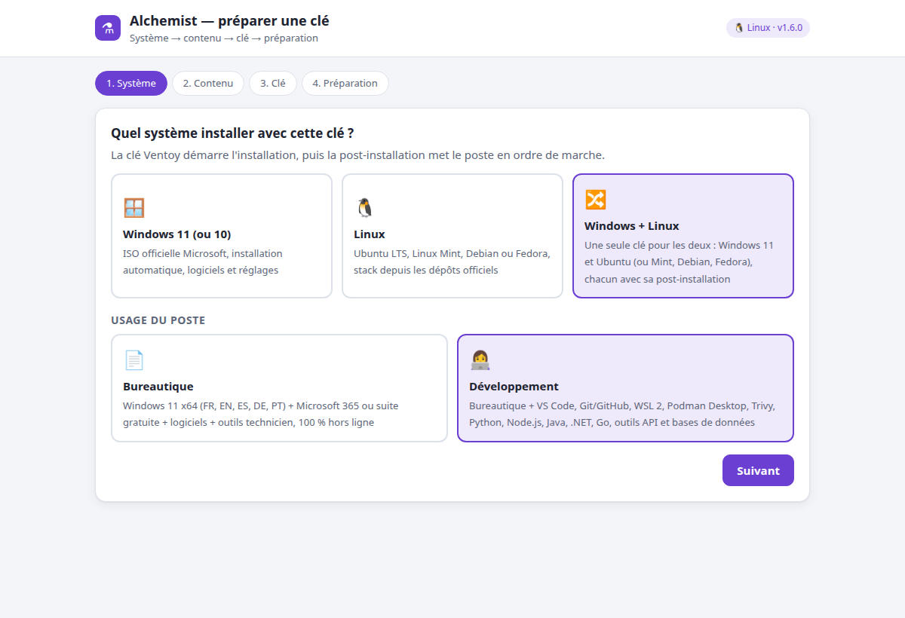
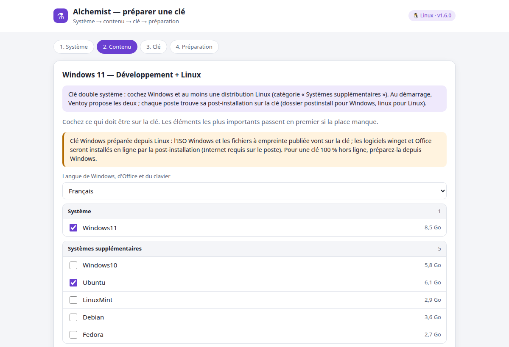
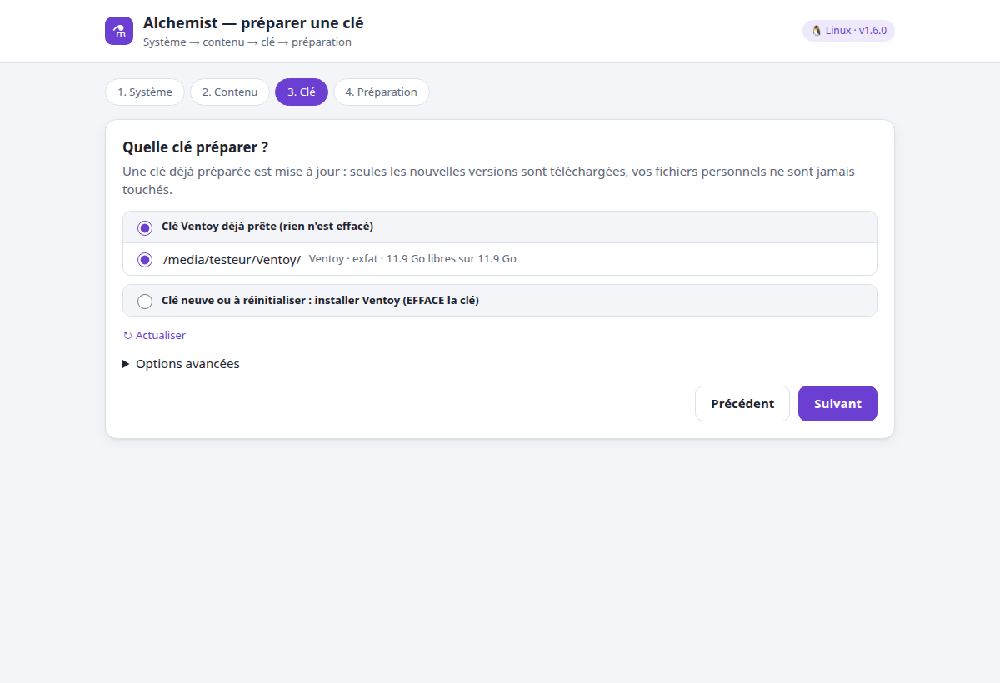
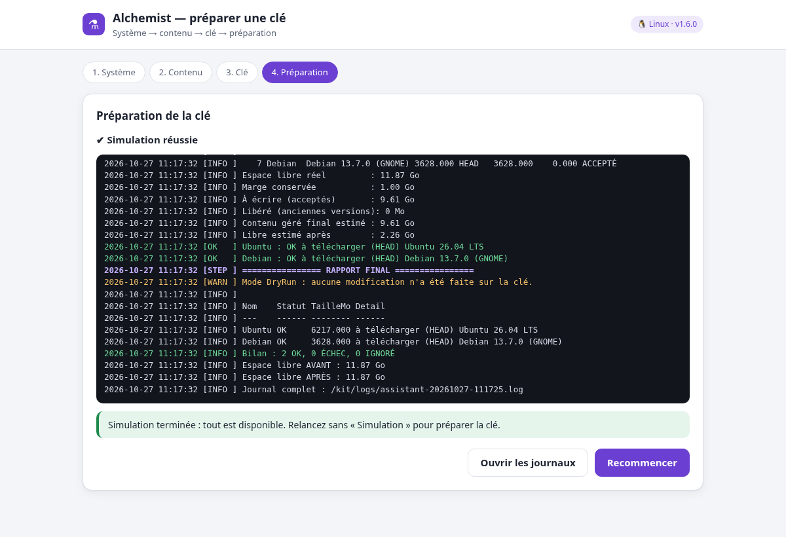
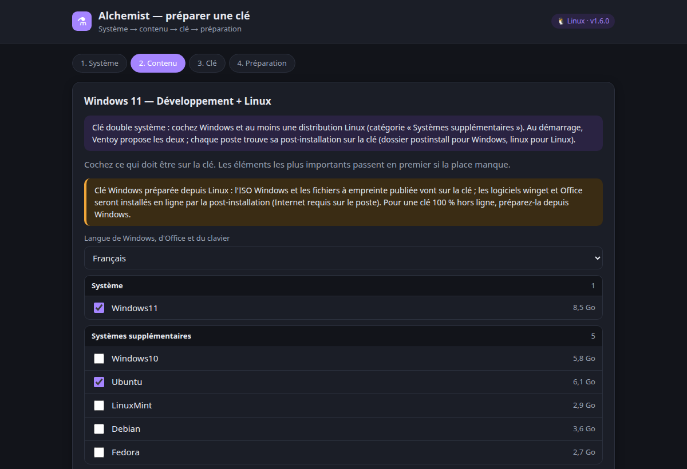
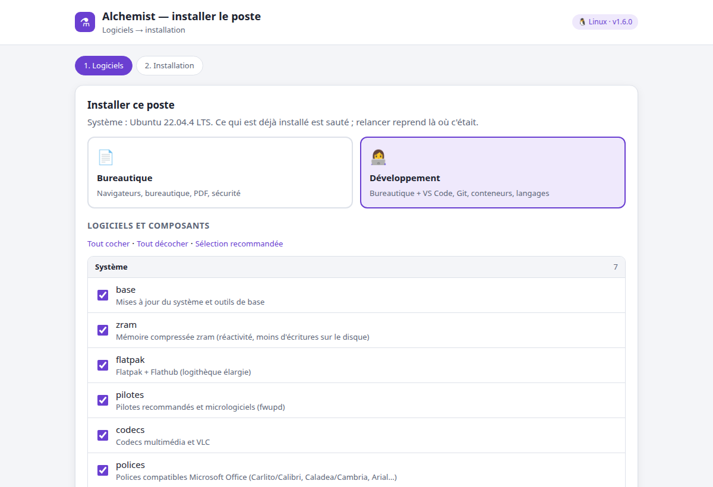
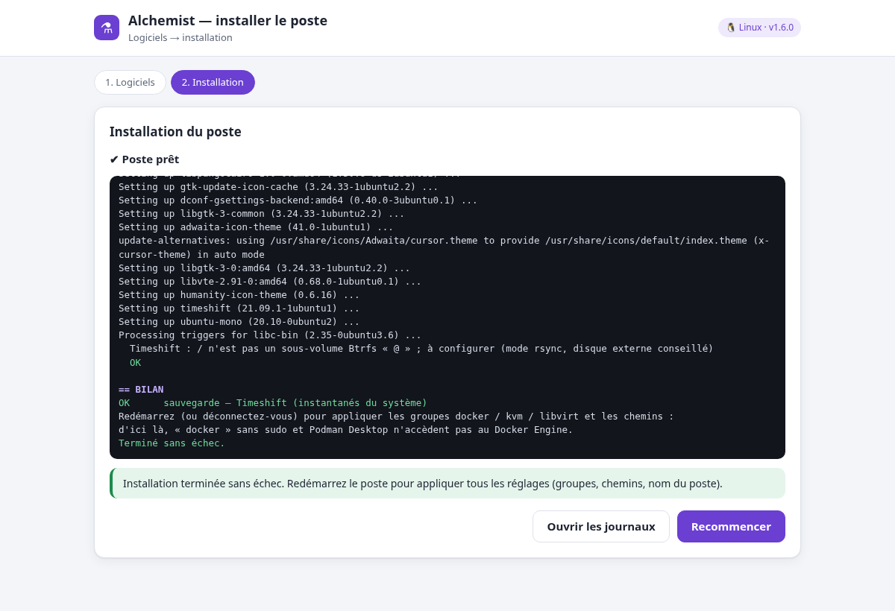
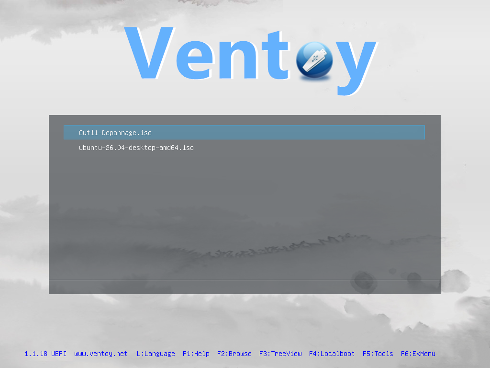

# ⚗️ Alchemist — transformez un PC nu en poste prêt à l'emploi

[](https://github.com/dreamdogbo/alchemist-usb/releases)
[](https://github.com/dreamdogbo/alchemist-usb/actions/workflows/lint.yml)
[](https://github.com/dreamdogbo/alchemist-usb/actions/workflows/tests-linux.yml)
[](https://github.com/dreamdogbo/alchemist-usb/actions/workflows/tests-windows.yml)
[](LICENSE)
[](https://semver.org/lang/fr/)
[](https://www.conventionalcommits.org/fr/)

> Une clé USB **Ventoy**, un assistant, et n'importe quel PC devient un poste **Windows 11** ou **Linux**
> (Ubuntu LTS, Linux Mint, Debian, Fedora) complet : système, bureautique, outils de développement,
> pilotes et réglages. La clé se prépare **depuis Windows ou depuis Linux**, pour **Windows, Linux ou les
> deux**, avec le **même assistant** partout. Pensé pour les techniciens, les mainteneurs et les développeurs.

**by [dreamdogbo](https://github.com/dreamdogbo)** · Windows et Linux · PowerShell 7 / Windows PowerShell 5.1 · 🇫🇷 Français · 🇬🇧 [English](#english-summary)



---

## Sommaire

- [En 30 secondes](#en-30-secondes)
- [Le parcours : Système → Usage → Versions → Clé](#le-parcours--système--usage--versions--clé)
- [Démarrage rapide — Windows](#démarrage-rapide--windows)
- [Démarrage rapide — Linux](#démarrage-rapide--linux)
- [Sur le poste à installer](#sur-le-poste-à-installer)
- [La stack](#la-stack)
- [Ligne de commande](#ligne-de-commande)
- [Sécurité et intégrité](#sécurité-et-intégrité)
- [Tests](#tests)
- [Personnaliser](#personnaliser)
- [Architecture](#architecture)
- [Versions et méthode de travail](#versions-et-méthode-de-travail)
- [Feuille de route](#feuille-de-route)
- [Limites connues](#limites-connues)
- [English summary](#english-summary)

## En 30 secondes

| | |
| --- | --- |
| 🧭 **Choix guidé** | Système (Windows / Linux / **les deux**) → usage (bureautique / développement) → contenu → clé |
| 🪄 **Un seul assistant** | même interface sous Windows et Linux, pour **créer la clé** et pour **installer le poste** (page locale dans le navigateur) |
| 🪟 **Windows 11** | ISO officielle (FR, EN, ES, DE, PT), Microsoft 365 hors ligne **ou** LibreOffice / ONLYOFFICE, logiciels, **installation 100 % hors ligne** |
| 🕰️ **Windows 10 / 7** | Windows 10 22H2 officiel en option (PC sans TPM 2.0) ; Windows 7 / 8.1 avec **votre** ISO + pack de compatibilité (.NET 4.8, PowerShell 5.1, Firefox ESR) |
| 🐧 **Linux** | Ubuntu LTS (recommandé), Linux Mint, Debian, Fedora — stack bureautique ou développeur via les dépôts officiels |
| 👩‍💻 **Développeurs** | VS Code (avec ses extensions essentielles), Git + GitHub CLI, Docker Engine natif + Podman Desktop, Trivy (scan de sécurité), WSL 2, Python/uv, Node.js LTS, Java, .NET, Go, Rust, Bruno, DBeaver… |
| 📄 **Microsoft 365 sous Linux** | **version de bureau intégrale** (vrai Word, Excel, PowerPoint, Outlook, OneNote) via LinOffice, + ONLYOFFICE |
| 🎨 **Création** | GIMP, Inkscape, Krita, Kdenlive, OBS… et la suite open source ArtCraft (PhotoCraft, VectorCraft, FilmCraft…) |
| 🔌 **Clé de A à Z** | installe / met à jour **Ventoy** lui-même (option, garde-fous), puis tout le reste en une fois |
| 🖥️ **Partout** | crée la clé depuis **Windows** (`Creer-Cle.bat`) ou **Linux** (`creer-cle.sh`), pour Windows, Linux ou une **clé double système** |
| 🔑 **Activation** | Windows activé avec la licence **du PC** s'il en a une (clé du fabricant, licence numérique) — jamais d'outil de contournement |
| 🛡️ **Sûr** | sources officielles, SHA256 vérifiés, signatures contrôlées, clé jamais formatée sans confirmation tapée |
| ♻️ **À jour** | relancer = mise à jour : seules les nouvelles versions sont téléchargées |

**Le dépôt ne contient aucun logiciel** : seulement des scripts (quelques centaines de Ko). Tout est
téléchargé au moment où vous préparez une clé, depuis les sources officielles, en dernière version stable.

## Le parcours : Système → Usage → Versions → Clé

Même assistant sous **Windows et Linux**, pour **créer la clé** comme pour **installer le poste** : une page
locale ouverte dans le navigateur (accessible seulement depuis ce PC). Les fenêtres classiques restent
disponibles (`Creer-Cle.bat -Classique`, `bash creer-cle.sh --zenity`) et servent de repli automatique.

1. **Système** : Windows, Linux, ou **Windows + Linux** (une seule clé pour les deux, chacun avec sa
   post-installation).
2. **Usage** : bureautique ou développement (détermine la stack proposée).
3. **Versions** : cases à cocher — Windows 11 dans la langue choisie ; pour Linux, Ubuntu LTS (dernière et
   précédente), Linux Mint, Debian, Fedora, et même Windows 11 pour un double démarrage.
4. **Clé** : une clé Ventoy détectée automatiquement, **ou une clé neuve** sur laquelle Alchemist installe
   Ventoy (après confirmation tapée).
5. **Préparation** : téléchargements vérifiés, suivis en direct, puis bilan.

| Contenu (clé double système) | Clé | Préparation |
| --- | --- | --- |
|  |  |  |

L'assistant suit le thème clair ou sombre du système, et s'adapte aux petits écrans.

<details>
<summary>Thème sombre</summary>



</details>

## Démarrage rapide — Windows

Prérequis : Windows 10/11 avec Internet, [winget](https://learn.microsoft.com/windows/package-manager/winget/)
(présent par défaut sur Windows 11), une clé USB de 32 Go ou plus.

```powershell
git clone https://github.com/dreamdogbo/alchemist-usb.git
```

ou téléchargez l'archive de la [dernière version](https://github.com/dreamdogbo/alchemist-usb/releases), puis
**double-cliquez `Creer-Cle.bat`** : l'assistant s'ouvre dans le navigateur. Choisissez « Clé neuve » si la clé
n'a pas encore Ventoy (les droits administrateur sont alors demandés). Fenêtre classique :
`Creer-Cle.bat -Classique`. Fermer l'onglet puis relancer `Creer-Cle.bat` rouvre la même session.

**Si la fenêtre ne s'ouvre pas** : un message indique la cause (archive non extraite, PowerShell restreint par
l'entreprise…) et le détail est dans `logs\demarrage-*.log`. Pour voir toutes les erreurs, lancez
`Creer-Cle.bat -Console` depuis une invite de commandes. Une **ancienne clé** que Ventoy refuse (ISO écrite
avec Rufus en mode DD, partitions verrouillées, disque en lecture seule) est remise à zéro puis réessayée
automatiquement en mode « Clé neuve ».

## Démarrage rapide — Linux

Prérequis : PowerShell 7 (proposé automatiquement : `sudo snap install powershell --classic`), un navigateur
(ou `zenity` pour les fenêtres classiques).

```bash
git clone https://github.com/dreamdogbo/alchemist-usb.git && cd alchemist-usb
bash creer-cle.sh
```

Depuis Linux, on prépare **toutes** les clés : Linux, Windows et double système. Pour une clé Windows,
l'ISO officielle (Windows 11 ou 10) et les fichiers à empreinte publiée vont sur la clé ; les logiciels winget
et Office, qui n'existent que sous Windows, sont installés **en ligne** par la post-installation (Internet
requis sur le poste). Pour une clé Windows 100 % hors ligne, préparez-la depuis Windows.

## Sur le poste à installer

**Windows** — démarrer sur la clé, choisir l'ISO Windows 11 puis le modèle `Windows11_HorsLigne.xml`
(compte local sans Internet), puis sur le bureau : **`postinstall\Lancer.bat`**. Windows est activé avec la
licence **du PC** s'il en a une (clé du fabricant inscrite dans le firmware, ou licence numérique d'un PC déjà
activé) ; sinon le bilan l'indique simplement.

**Linux** — démarrer sur la clé, choisir la distribution, installer, puis dans le dossier `linux` de la clé :
`bash lancer.sh` (même assistant que sous Windows, Python suffit ; Internet requis). En mode développement,
VS Code est installé avec ses extensions essentielles (français, Python, Dev Containers, EditorConfig),
sous Windows comme sous Linux.

| Choix des logiciels | Installation suivie en direct |
| --- | --- |
|  |  |

La même page sert sous Windows (`postinstall\Lancer.bat`, état de chaque logiciel : déjà installé, sur la clé,
en ligne) et sous Linux (`linux/lancer.sh`). Fenêtres classiques : `Lancer.bat -Classique`, `bash lancer.sh --zenity`.

## La stack

Résumé ci-dessous ; le détail complet est dans **[docs/STACK.md](docs/STACK.md)**.

| | Bureautique | Développement (en plus) |
| --- | --- | --- |
| **Windows** | Microsoft 365 / LibreOffice / ONLYOFFICE, Chrome, Firefox, Acrobat Reader, PDF24, PDFCraft, 7-Zip, VLC, Notepad++, ShareX, Teams, Zoom, Chocolatey + GUI, ClamAV | VS Code, PowerShell 7, PowerToys, Git, GitHub CLI, WSL 2, Podman + Podman Desktop, Trivy, Python, Node.js LTS, Java, .NET SDK, Bruno, DBeaver, KeePassXC |
| **Linux** | **Microsoft 365 de bureau intégral (LinOffice)**, ONLYOFFICE, LibreOffice, Chrome, PDFCraft, Okular, Zoom, polices Office, ClamAV, pare-feu, Timeshift | VS Code, Git + gh + lazygit, Docker Engine + Podman Desktop, Trivy, KVM, Python + uv, Node.js LTS, Java, .NET, Go, Rust, Bruno, DBeaver, outils terminal |
| **Options** | Création (GIMP, Inkscape, Krita, Kdenlive, OBS…), suite ArtCraft, WinBoat (autres applications Windows), DevOps, JetBrains Toolbox, Docker Desktop (licence payante en entreprise/administration) | |

## Ligne de commande

```powershell
# Windows ou Linux (PowerShell 7)
./Build-Kit.ps1 -Systeme Windows -Usage Developpement -DryRun     # simulation
./Build-Kit.ps1 -Systeme Linux -Usage Developpement -Avec LinuxMint
./Build-Kit.ps1 -Systeme Windows -Usage Bureautique -SansOffice -Avec LibreOffice -Langue en
./Build-Kit.ps1 -InstallerVentoy -Disque 2 -ConfirmerEffacement EFFACER-2                  # Windows : clé neuve
sudo pwsh ./Build-Kit.ps1 -Systeme Linux -InstallerVentoy -Disque /dev/sdb -ConfirmerEffacement EFFACER-sdb
./Build-Kit.ps1 -MettreAJourVentoy                                # Ventoy à jour, données conservées
./Build-Kit.ps1 -ListerProfils
```

| Paramètre | Rôle |
| --- | --- |
| `-Systeme Windows\|Linux` `-Usage Bureautique\|Developpement` | choix du profil (ou `-Profil <nom>`) |
| `-Langue fr\|en\|es\|de\|pt` | langue de l'ISO Windows, d'Office et du clavier |
| `-Only a,b` / `-Avec a,b` / `-SansOffice` | sélection exacte / ajout d'options / sans Microsoft 365 |
| `-DriveLetter E` (Windows) / `-KeyPath /media/moi/Ventoy` (Linux) | clé (sinon détection automatique) |
| `-InstallerVentoy -Disque … -ConfirmerEffacement EFFACER-…` | clé neuve : installe Ventoy (efface le disque), options `-VentoyGPT`, `-VentoyFS`, `-VentoySansSecureBoot` |
| `-MettreAJourVentoy` | met Ventoy à jour sans effacer |
| `-DryRun`, `-SkipDownload` | simulation ; mise en place hors ligne depuis le cache |
| `-SansVerifSignature` | Authenticode non exigé (les SHA256 publiés restent vérifiés) |
| `-SauvegardeVers <dossier>` `[-SauvegardeComplete]` | sauvegarde préalable des données de la clé |
| `-WindowsIsoUrl <url>` | lien officiel Microsoft si Fido est bloqué |
| `-ListerProfils [-Json]`, `-ListerElements` | informations pour scripts et assistants |

Codes de sortie : `0` OK · `1` au moins un ÉCHEC · `2` erreur / clé invalide · `3` source officielle du système ou d'Office introuvable.

Post-installation Linux : `installer-poste.sh -u bureautique|developpement [-c id1,id2] [-t] [-n] [-y] [--liste]`.
Post-installation Windows : `Install-Poste.ps1 [-Logiciels a,b] [-AvecOutils] [-SansOffice] [-NomPoste X] [-SansReglages]`.

## Sécurité et intégrité

- **Sources officielles uniquement** : Microsoft, éditeurs, dépôt winget, releases GitHub stables, sites des
  distributions, dépôts apt/dnf officiels, Flathub. **Aucune ISO modifiée, aucun outil d'activation** :
  licences légitimes uniquement.
- **SHA256** publiés (winget, GitHub, distributions, Go) toujours vérifiés ; `MANIFEST.sha256` permet de
  vérifier toute la clé (`sha256sum -c MANIFEST.sha256`).
- **Signatures Authenticode** contrôlées sous Windows (désactivables, tracé dans le journal).
- **Préparer ou mettre à jour une clé ne la formate jamais** ; seuls les fichiers du kit sont modifiés.
- **Clé neuve (option)** : USB/SD uniquement, jamais le disque système ni celui où se trouve Alchemist,
  confirmation tapée, droits administrateur, sauvegarde proposée.
- **Rien de lourd sur votre ordinateur** : la zone de téléchargement est **sur la clé** (`kit-cache`).

## Personnaliser

- **Logiciel Windows** : un bloc dans `config/profils/windows11-*.psd1` (types `Winget`, `GitHub`, `Url`).
- **Composant Linux** : une ligne dans `COMPOSANTS` et une fonction `comp_<id>` dans
  `payload/linux/linux/installer-poste.sh` (helpers `paquets "deb" "rpm"`, `flatpak_installer`, `github_paquet`).
- **Nouveau profil** : un fichier dans `config/profils/` ; il peut **hériter** d'un autre (`Herite`, `Items`,
  `Retirer`, `ParDefaut`, `NonParDefaut`).
- **Langue d'interface** : copier `lang/fr.psd1` (et `payload/windows/postinstall/lang/fr.psd1`) en `xx.psd1`.

## Architecture

```text
alchemist-usb/
├── web/alchemist.html                assistant universel (même page : création de clé et post-installation)
├── Assistant-Web.ps1                 serveur local de création de clé (Windows PowerShell 5.1 / PowerShell 7)
├── Creer-Cle.bat / Assistant.ps1     lanceur Windows ; fenêtre classique (-Classique) ; modules/Lanceur.ps1
├── creer-cle.sh                      lanceur Linux ; fenêtres zenity (--zenity)
├── Build-Kit.ps1                     moteur (Windows et Linux, PowerShell 7 / 5.1)
├── config/profils/*.psd1             profils Système × Usage (héritage)
├── modules/                          Drive, Ventoy, Profile, Budget, Download, Sync, Backup, Report
├── payload/windows/                  copié sur les clés Windows (post-installation, LISEZMOI, Ventoy)
├── payload/linux/                    copié sur les clés Linux (linux/lancer.sh, installer-poste.sh)
├── lang/                             textes des assistants (FR, EN…)
├── tests/moteur/                     tests du moteur, clé factice de bout en bout, création réelle + démarrage VM
├── tests/linux/                      post-installation Linux (simulation, installation réelle en conteneur)
└── docs/                             STACK.md, captures
```

## Tests

| Commande | Ce qui est vérifié |
| --- | --- |
| `pwsh tests/moteur/Test-Moteur.ps1` | profils, langues, budget, MANIFEST, fichiers personnels, catalogue (Windows 5.1 / 7 et Linux) |
| `bash tests/moteur/test-cle-factice.sh` | clé Ventoy factice : clés Linux, Windows et double système depuis Linux, garde-fous, assistants universels, installation réelle par l'assistant |
| `bash tests/moteur/test-ventoy-reel.sh` | Ventoy officiel réellement installé sur un disque vierge, vrais téléchargements, mise à jour, **démarrage de la clé en BIOS et UEFI** (QEMU) |
| `bash tests/linux/test-installation-reelle.sh` | post-installation Linux réelle (Git, VS Code, Python, Trivy, .NET) sur Ubuntu et Debian |
| GitHub Actions `Tests Windows` | sur une vraie machine Windows : clé factice préparée **depuis Windows pour chaque destination** (Windows, Linux, double système), vrais téléchargements, post-installation réelle depuis la clé, assistants universels sous PowerShell 5.1 |

La clé créée par `test-ventoy-reel.sh` démarre réellement, en BIOS comme en UEFI :

| BIOS | UEFI |
| --- | --- |
|  |  |

## Versions et méthode de travail

- **Versions** : [SemVer](https://semver.org/lang/fr/), source unique [`VERSION`](VERSION) ;
  historique dans le [CHANGELOG](CHANGELOG.md) (Keep a Changelog).
- **Développement** : GitHub Flow (`main` stable, branches `feat/…`, Pull Requests), commits
  [Conventional Commits](https://www.conventionalcommits.org/fr/), CI (PSScriptAnalyzer, shellcheck, simulation
  sur Ubuntu / Debian / Fedora / Mint), publication automatique à chaque étiquette `vX.Y.Z`.
- Détails : [CONTRIBUTING](CONTRIBUTING.md) · Sécurité : [SECURITY](SECURITY.md) · Évolutions : [ROADMAP](ROADMAP.md).

## Feuille de route

- [x] Windows 11 hors ligne, Microsoft 365 ou suites gratuites, assistants FR/EN (v1.0)
- [x] Installation / mise à jour de Ventoy (v1.1)
- [x] Système × usage, Linux multi-distributions, stack développeur, création de clé depuis Linux (v1.2)
- [x] Assistant universel Windows / Linux, clé Windows depuis Linux, clé double système, activation avec la
  licence du PC, tests réels (création, démarrage BIOS/UEFI, post-installation)
- [ ] Installation Linux automatisée (autoinstall / kickstart), paquets Linux hors ligne sur la clé
- [ ] Profils statistiques / données et graphisme
- [ ] Assistant de migration Windows → Linux (données, SSH, Git, extensions VS Code)

Détails : [ROADMAP.md](ROADMAP.md).

## Limites connues

- **Fido** : Microsoft bloque parfois les téléchargements automatisés → lien officiel (`-WindowsIsoUrl`, ou champ
  « Lien de l'ISO » de l'assistant) ou ISO déposée dans le cache ; une ISO déjà sur la clé est conservée.
- **Clé Windows préparée depuis Linux** : logiciels winget et Office installés en ligne sur le poste.
- **Post-installation Linux** : en ligne (dépôts officiels) ; l'installation hors ligne viendra plus tard.
- **Compte local Windows hors ligne** : Microsoft durcit l'OOBE ; repli `Maj+F10` → `start ms-cxh:localonly`.
- La suite **ArtCraft** est encore jeune (versions 0.x) : proposée en option.
- **Clé en FAT32** : aucun fichier de 4 Go ou plus (ISO de Windows) ; le kit le signale avant de télécharger.
  Réinstallez Ventoy en exFAT (case « Clé neuve »).

---

## English summary

**Alchemist** turns a bare PC into a ready-to-use **Windows 11** or **Linux** (Ubuntu LTS, Mint, Debian, Fedora)
workstation from a single **Ventoy** USB key. Pick the **system**, the **usage** (office / development) and the
**versions**; Alchemist downloads everything from official sources (latest stable, SHA256-verified), can install
Ventoy itself, and works from **Windows** (`Creer-Cle.bat`) or **Linux** (`creer-cle.sh`) with the **same assistant**
(a local page opened in the browser), for **Windows, Linux or both on one key**. Windows keys prepared from Windows
install fully **offline** (prepared from Linux, winget software and Office are installed online on the PC); Linux keys install the stack from official repositories (VS Code, native Docker Engine + Podman Desktop,
Trivy, Git/gh, Python/uv, Node.js, Java, .NET, Go, Rust, full desktop Microsoft 365 via LinOffice, ONLYOFFICE…). See [docs/STACK.md](docs/STACK.md).
Docker Desktop is no longer checked by default (paid licence for public sector and large organisations; extra VM
on Linux): Podman Desktop drives the native Docker Engine and Podman instead. No activation tools: Windows is activated
only with the PC's own licence (firmware OEM key or digital licence), if it has one. Tested for real: key creation,
BIOS/UEFI boot in a VM, Linux post-install on Ubuntu and Debian, and a Windows CI run for each destination.

---

Conçu et maintenu par **[dreamdogbo](https://github.com/dreamdogbo)** · Contributions bienvenues : [CONTRIBUTING.md](CONTRIBUTING.md).
