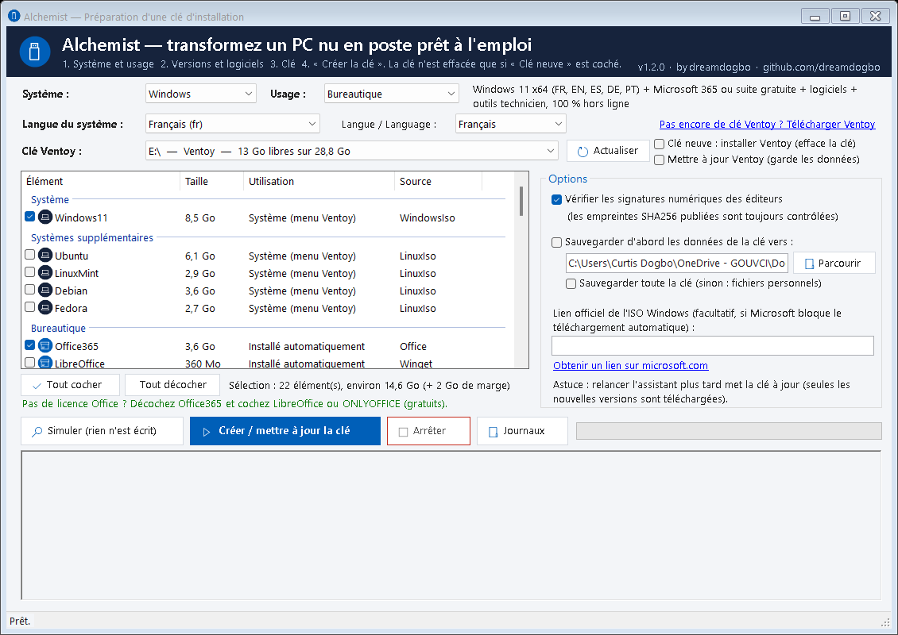
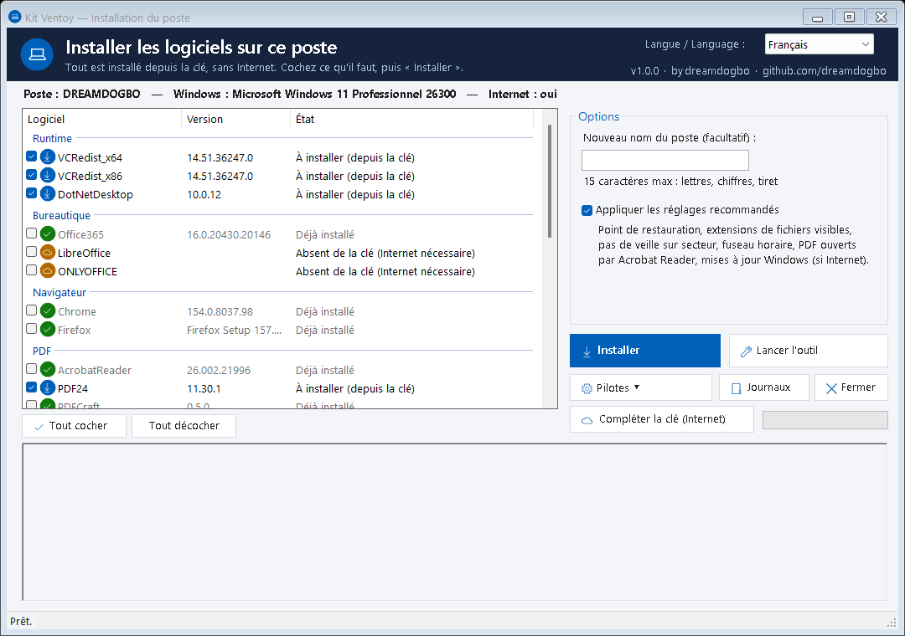

# Kit Ventoy — clés d'installation prêtes à l'emploi

[](https://github.com/dreamdogbo/kit-ventoy/releases)
[](https://github.com/dreamdogbo/kit-ventoy/actions/workflows/lint.yml)
[](LICENSE)
[](https://semver.org/lang/fr/)
[](https://www.conventionalcommits.org/fr/)

> Préparez en quelques clics une **clé USB Ventoy** qui installe un poste Windows 11 complet
> **sans Internet** : système, suite bureautique, logiciels, pilotes et réglages.
> Pensé pour les techniciens, les mainteneurs et les services informatiques.

**by [dreamdogbo](https://github.com/dreamdogbo)** · Licence MIT · Windows PowerShell 5.1 et PowerShell 7 · 🇫🇷 Français · 🇬🇧 [English summary](#english-summary)



---

## Sommaire

- [Ce que fait le kit](#ce-que-fait-le-kit)
- [Le dépôt ne contient aucun logiciel](#le-dépôt-ne-contient-aucun-logiciel)
- [Démarrage rapide (3 clics)](#démarrage-rapide-3-clics)
- [Sur le poste à installer](#sur-le-poste-à-installer)
- [Contenu de la clé](#contenu-de-la-clé)
- [Ligne de commande (experts, automatisation)](#ligne-de-commande-experts-automatisation)
- [Mettre la clé à jour](#mettre-la-clé-à-jour)
- [Personnaliser : logiciels, langues, profils](#personnaliser--logiciels-langues-profils)
- [Sécurité et intégrité](#sécurité-et-intégrité)
- [Architecture du projet](#architecture-du-projet)
- [Versions et méthode de travail](#versions-et-méthode-de-travail)
- [Feuille de route](#feuille-de-route)
- [Limites connues](#limites-connues)
- [English summary](#english-summary)

---

## Ce que fait le kit

| | |
| --- | --- |
| 🪟 **Windows 11 officiel** | ISO Microsoft (via [Fido](https://github.com/pbatard/Fido)), langue au choix : FR, EN, ES, DE, PT |
| 📄 **Bureautique** | Microsoft 365 Apps hors ligne (ODT) **ou** suites gratuites **LibreOffice** / **ONLYOFFICE** |
| 📦 **Logiciels** | Chrome, Firefox, Acrobat Reader, PDF24, PDFCraft, 7-Zip, VLC, Notepad++, ShareX, Teams, Zoom, Chocolatey + Chocolatey GUI, VC++ et .NET |
| 🛡️ **Antivirus** | **ClamAV** (open source, Cisco Talos) en analyse à la demande ; Microsoft Defender reste la protection temps réel |
| 🔧 **Outils technicien** | Snappy Driver Installer Origin (pilotes), CrystalDiskInfo, HWiNFO |
| 🐧 **Multiboot** | Ubuntu LTS, Linux Mint, Debian, Fedora (optionnels, dernière version stable) |
| 🖱️ **Fenêtres** | Assistant de création de clé + assistant d'installation du poste, sans console |
| 🌍 **Multilingue** | Interface FR / EN (fichiers de langue extensibles) ; contenu (ISO, Office, clavier) multilingue |
| 🛡️ **Sûr** | Sources officielles uniquement, SHA256 vérifiés, signatures Authenticode (désactivable), clé **jamais formatée** |
| ♻️ **Idempotent** | Relancer = mise à jour : seules les nouvelles versions sont téléchargées et remplacent les anciennes |
| 💾 **Sauvegarde** | Option de sauvegarde des données présentes sur la clé avant préparation |

## Le dépôt ne contient aucun logiciel

Le dépôt ne contient **que des scripts, la configuration et la documentation** (quelques centaines de Ko).
Aucun installeur ni aucune ISO n'y est stocké : tout est téléchargé **au moment où vous préparez une clé**,
depuis les sources officielles, dans la **dernière version stable du jour** :

- logiciels hébergés sur GitHub (PDFCraft, Chocolatey, Chocolatey GUI…) : API GitHub `releases/latest`,
  qui exclut brouillons et pré-versions, avec contrôle du SHA256 publié par GitHub ;
- logiciels winget : manifeste stable du dépôt winget, SHA256 contrôlé ;
- Windows 11 (Microsoft via Fido), Office (CDN Office, canal Current), Linux (dernière version stable de
  chaque distribution, liste d'empreintes officielle).

Un simple `git pull` récupère les évolutions du kit ; relancer l'assistant met la clé à jour.

## Démarrage rapide (3 clics)

**Prérequis** : un PC Windows 10/11 avec Internet, [winget](https://learn.microsoft.com/windows/package-manager/winget/)
(« App Installer », présent par défaut sur Windows 11) et une clé USB de **32 Go** ou plus.

1. **Installer Ventoy sur la clé** (une seule fois) avec l'outil officiel :
   [ventoy.net](https://www.ventoy.net/fr/download.html) → `Ventoy2Disk.exe` → *Installer*.
2. **Récupérer le kit** :

   ```powershell
   git clone https://github.com/dreamdogbo/kit-ventoy.git
   ```

   ou *Code → Download ZIP*, puis décompresser. Astuce : copiez le dossier `kit-ventoy` **sur la clé
   elle-même** — les téléchargements sont alors simplement *déplacés* (rapide, pas d'espace en double)
   et la clé pourra se compléter seule depuis n'importe quel poste.
3. **Double-cliquer `Creer-Cle.bat`** : choisir le type de clé, la langue, cocher les logiciels,
   puis **« Créer / mettre à jour la clé »**. Le journal défile en direct ; à la fin, la clé est prête.

> Pas de licence Office ? Décochez **Office365** et cochez **LibreOffice** ou **ONLYOFFICE**.

## Sur le poste à installer

1. Démarrer sur la clé (F12/F11/F9/Échap selon la marque) → menu Ventoy.
2. Choisir l'ISO Windows 11 puis le modèle **`Windows11_HorsLigne.xml`** : compte **local** sans
   Internet, langue et clavier prêts. *Aucun partitionnement automatique : le disque est choisi à la main.*
3. Sur le bureau : **`postinstall\Lancer.bat`** → fenêtre d'installation :

   

   - état de chaque logiciel (déjà installé / à installer / absent), cases à cocher ;
   - nom du poste, réglages recommandés (point de restauration, extensions visibles, pas de veille
     sur secteur, fuseau horaire, PDF → Acrobat Reader, Windows Update si Internet) ;
   - **Pilotes (SDIO)**, outils portables, **Compléter la clé (Internet)** pour télécharger sur la clé
     ce qui y manque.
4. Mode sans fenêtre : `Lancer.bat -Auto` (options `-SansOffice`, `-NomPoste PC-012`).

## Contenu de la clé

```text
/ISO/Windows11_FR_x64.iso            Windows 11 (nom selon la langue)
/ISO/Linux/<Distribution>/*.iso      Systèmes Linux optionnels
/Bureautique/Office365/              setup.exe + config.xml + Office\ (hors ligne)
/Bureautique/LibreOffice|ONLYOFFICE  Suites gratuites (optionnelles)
/Logiciels/<Nom>/                    installeur + manifeste winget + silent.txt + <Nom>.source.json
/postinstall/                        Lancer.bat, Pilotes.bat, Assistant-Poste.ps1, Install-Poste.ps1, catalogue.json
/ventoy/                             ventoy.json + modèle d'installation hors ligne
/LISEZMOI.txt, /README.txt           Guide d'une page (FR / EN) pour le technicien
/MANIFEST.sha256                     Empreintes de tous les fichiers du kit (sha256sum -c)
/kit-ventoy/                         (optionnel) le kit lui-même, pour compléter/mettre à jour la clé
```

## Ligne de commande (experts, automatisation)

```powershell
.\Build-Kit.ps1 -DryRun                                   # simulation : sources + budget d'espace
.\Build-Kit.ps1                                           # clé Ventoy détectée automatiquement
.\Build-Kit.ps1 -Langue en -SansOffice -Avec LibreOffice  # clé anglaise, suite gratuite
.\Build-Kit.ps1 -Avec Ubuntu,LinuxMint                    # + systèmes Linux (multiboot)
.\Build-Kit.ps1 -Only Chrome,Firefox                      # mettre à jour seulement ces éléments
.\Build-Kit.ps1 -SauvegardeVers D:\Sauvegardes            # sauvegarder d'abord les fichiers de la clé
.\Build-Kit.ps1 -SansVerifSignature                       # ne pas exiger les signatures Authenticode
.\Build-Kit.ps1 -ListerProfils                            # types de clé disponibles
```

| Paramètre | Rôle |
| --- | --- |
| `-Profil <nom>` | type de clé (`config\profils\<nom>.psd1`), défaut `windows11-bureautique` |
| `-Langue fr\|en\|es\|de\|pt` | langue de l'ISO Windows, d'Office et du clavier |
| `-DriveLetter E` | lettre de la clé (sinon détection automatique du volume « Ventoy ») |
| `-Only a,b` / `-Avec a,b` | liste exacte / ajout d'éléments facultatifs |
| `-SansOffice` | sans Microsoft 365 |
| `-SkipDownload` | hors ligne : met en place ce qui est complet dans `cache\` |
| `-DryRun` | simulation, rien n'est écrit |
| `-SansVerifSignature` | Authenticode non exigé (les SHA256 publiés restent vérifiés) |
| `-SauvegardeVers <dossier>` `[-SauvegardeComplete]` | sauvegarde préalable (fichiers personnels ou toute la clé) |
| `-WindowsIsoUrl <url>` | lien officiel Microsoft si Fido est bloqué |
| `-CachePath`, `-LogFile` | zone de préparation, journal imposé |

Codes de sortie : `0` OK · `1` au moins un ÉCHEC · `2` clé invalide/erreur · `3` source officielle du système ou d'Office introuvable.

Post-installation en ligne de commande : `Install-Poste.ps1 [-Logiciels a,b] [-AvecOutils] [-SansOffice] [-NomPoste X] [-SansReglages]`.

## Mettre la clé à jour

Relancez simplement l'assistant (ou `Build-Kit.ps1`). Pour chaque élément :
winget → SHA256 publié · GitHub → `digest` de la release · éditeurs → nom/taille/date ·
Windows → nom et taille de l'ISO officielle · Office → version du canal · Linux → liste d'empreintes officielle.
Ce qui est à jour n'est ni retéléchargé ni recopié ; une nouvelle version **remplace** l'ancienne (pas de cumul).
Un téléchargement interrompu **reprend** où il s'était arrêté.

## Personnaliser : logiciels, langues, profils

**Ajouter un logiciel** — un bloc dans `config\profils\windows11-bureautique.psd1` :

```powershell
@{
    Name = 'GIMP'; Category = 'Graphisme'; Type = 'Winget'; Priority = 5; TargetDir = 'Logiciels/GIMP'
    WingetId = 'GIMP.GIMP.3'; Architecture = 'x64'; EstimatedSizeMB = 350
    Signer = ''                                   # regex de l'éditeur (Authenticode), '' = SHA256 winget suffit
    SilentArgs = '/VERYSILENT /NORESTART /ALLUSERS'; SuccessCodes = @(0)
    Detection = 'reg:^GIMP'; Order = 60           # reg: | appx: | c2r: | file: | ''
}
```

Types de source : `Winget`, `GitHub` (`Repo`, `AssetPattern`, dernière release stable), `Url` (lien éditeur,
signature obligatoire), `Office`, `WindowsIso`, `LinuxIso` (`Distro`). Options : `Mode = 'Manuel'` (outil à la
demande), `Default = $false` (non coché), `Extract = $true` + `Launcher` (outil portable).

**Ajouter une langue d'interface** — copier `lang\fr.psd1` (et `payload\windows\postinstall\lang\fr.psd1`)
en `xx.psd1`, traduire les valeurs. Elle apparaît automatiquement dans les fenêtres.

**Ajouter une langue de contenu** — rubrique `Langues` du profil (`FidoLang`, `Office`, `UILang`, `InputLocale`).

**Créer un type de clé** — nouveau fichier dans `config\profils\` (copie du profil existant) : il apparaît
dans la liste « Type de clé » de l'assistant.

## Sécurité et intégrité

- **Sources officielles uniquement** : Microsoft, éditeurs, dépôt winget, releases GitHub officielles, sites
  des distributions Linux. **Aucune ISO modifiée, aucun outil d'activation** : Windows et Office s'activent
  avec des licences légitimes (licence du PC, KMS/MAK de l'organisation, compte Microsoft 365).
- **SHA256** : publié par winget / GitHub / la distribution, toujours vérifié ; enregistré dans `MANIFEST.sha256`
  (`sha256sum -c MANIFEST.sha256` vérifie toute la clé).
- **Authenticode** : signature de l'éditeur contrôlée (exigée pour les liens directs) ; désactivable avec
  `-SansVerifSignature` (ou la case dans l'assistant) — les SHA256 restent contrôlés.
- **Antivirus** : Microsoft Defender (intégré à Windows 11) assure la protection en temps réel ; le kit ajoute **ClamAV**
  (open source) pour les analyses à la demande, configuré automatiquement (signatures mises à jour dès qu'Internet est
  disponible). Deux antivirus temps réel simultanés sont volontairement évités (conflits, lenteurs).
- **La clé n'est jamais formatée ni repartitionnée** ; seuls les fichiers listés dans le MANIFEST sont
  remplacés ou supprimés. Un fichier personnel au même emplacement n'est jamais écrasé.

## Architecture du projet

```text
kit-ventoy/
├── Creer-Cle.bat / Assistant.ps1     fenêtre de création de clé
├── Build-Kit.ps1                     moteur (ligne de commande)
├── config/profils/*.psd1             types de clé (catalogues)
├── config/office-config.xml          configuration Office Deployment Tool
├── lang/*.psd1                       textes de l'assistant (FR, EN, …)
├── modules/                          Drive, Budget, Download, Sync, Backup, Report
├── payload/windows/                  copié sur la clé : postinstall (fenêtre + moteur + thème), ventoy, LISEZMOI
├── docs/                             captures d'écran
└── .github/workflows/lint.yml        PSScriptAnalyzer à chaque push
```

## Versions et méthode de travail

- **Versions** : [gestion sémantique](https://semver.org/lang/fr/) `MAJEUR.MINEUR.CORRECTIF` ; source unique [`VERSION`](VERSION),
  affichée dans les fenêtres, les journaux et sur la clé. Historique : [CHANGELOG](CHANGELOG.md) (Keep a Changelog).
- **Téléchargement d'une version** : page [Releases](https://github.com/dreamdogbo/kit-ventoy/releases) (archive prête à l'emploi),
  ou `git clone` puis `git checkout vX.Y.Z`.
- **Développement** : GitHub Flow (`main` stable, branches `feat/…` / `fix/…`, Pull Requests), commits
  [Conventional Commits](https://www.conventionalcommits.org/fr/), intégration continue (PSScriptAnalyzer), publication
  automatique à chaque étiquette `vX.Y.Z`. Détails : [CONTRIBUTING](CONTRIBUTING.md) · Sécurité : [SECURITY](SECURITY.md).

## Feuille de route

- [x] **v1.0** : Windows 11 + Office/LibreOffice/ONLYOFFICE + logiciels + pilotes + ClamAV, hors ligne, fenêtres FR/EN, multiboot Linux.
- [ ] **v1.1** : installer / mettre à jour **Ventoy** depuis l'assistant, puis tout le reste en une seule opération.
- [ ] **v1.2** : profils par usage (bureautique, développement, statistiques, graphisme/vidéo).
- [ ] **v2.0** : outil **universel** (créer la clé depuis Windows, Linux ou macOS : moteur PowerShell 7, interface multiplateforme).
- [ ] **v2.x** : Linux de première classe (installation automatisée, profil développeur : Docker, VS Code, langages ;
      Microsoft 365 sous Linux ; équivalents Adobe : Inkscape, GIMP/Krita, Kdenlive/DaVinci Resolve, PDFCraft).
- [ ] **v2.1** : assistant de migration Windows → Linux.

Détails : [ROADMAP.md](ROADMAP.md).

## Limites connues

- **Fido** : Microsoft bloque parfois les téléchargements automatisés → champ « Lien officiel de l'ISO »
  (ou `-WindowsIsoUrl`), ou ISO déposée dans `cache\Windows11\` + `-SkipDownload`. Si l'ISO est déjà sur la
  clé, elle est conservée.
- **Compte local hors ligne** : Microsoft durcit régulièrement l'OOBE ; repli `Maj+F10` → `start ms-cxh:localonly`.
- **Sites temporairement injoignables** (ex. SDIO) : l'élément est signalé ÉCHEC sans bloquer le reste ;
  relancer plus tard le récupère.
- Les messages du journal technique sont en français (l'interface est multilingue).

---

## English summary

**Ventoy Kit** builds a ready-to-use **Ventoy USB key** that installs a complete Windows 11 workstation
**offline**: official Windows 11 ISO (FR/EN/ES/DE/PT), Microsoft 365 Apps offline **or** free suites
(LibreOffice / ONLYOFFICE), common software, Chocolatey + GUI, driver tool (SDIO), technician tools, and optional
Linux systems (Ubuntu LTS, Mint, Debian, Fedora) for multiboot.

- **Build the key**: install Ventoy on the key once, clone this repo, double-click **`Creer-Cle.bat`**, pick the
  key type, language and software, click **Build**. Everything comes from official sources, with SHA256 checks
  and (optional) Authenticode checks. The key is **never formatted**; running again **updates** it.
- **On the target PC**: boot the key, pick the Windows ISO and the `Windows11_HorsLigne.xml` template (local
  account, no Internet), then run **`postinstall\Lancer.bat`**: a window lets you choose what to install,
  name the computer, apply recommended settings, launch the driver tool or complete the key from the Internet.
- **CLI**: `Build-Kit.ps1 -Langue en -SansOffice -Avec LibreOffice`, `-DryRun`, `-Only`, `-SauvegardeVers`…
- **Interface languages**: French and English; add one by translating `lang\fr.psd1`.

No activation tools are included: use legitimate licences only.

---

Conçu et maintenu par **[dreamdogbo](https://github.com/dreamdogbo)**. Contributions bienvenues : voir [CONTRIBUTING.md](CONTRIBUTING.md).
